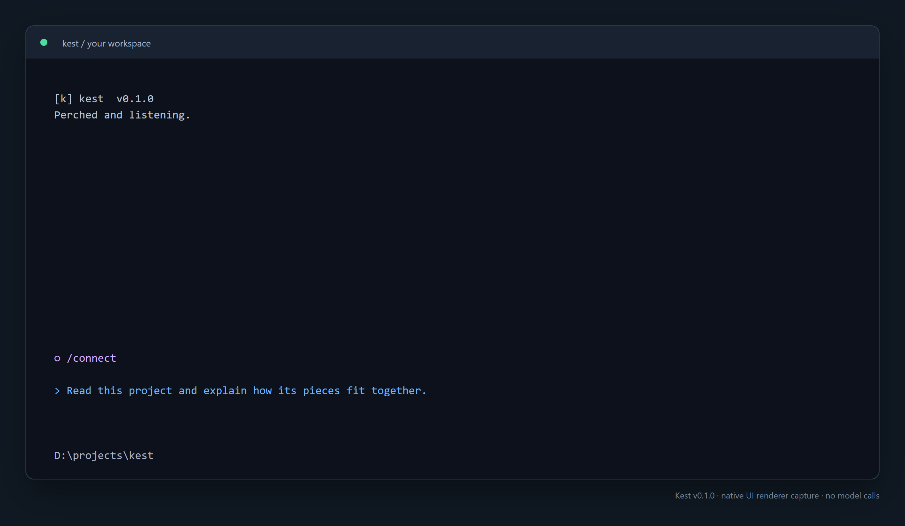
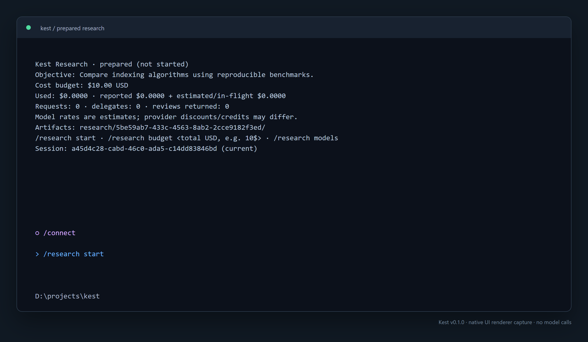

<div align="center">

# Kest

**A coding agent. A research team. One terminal.**

Read code, run experiments, and coordinate research with a shared dollar budget.

[](https://github.com/agkomyint/kest/actions/workflows/ci.yml)
[](https://github.com/agkomyint/kest/releases)
[](https://bun.sh)

[Download](https://github.com/agkomyint/kest/releases/latest) · [Research](#research-with-a-budget) · [Commands](#commands) · [Reference](docs/reference.md)

</div>



<p align="center"><sub>Real Kest UI output captured with OpenTUI’s native renderer. Example workspace; no model calls. Renderer captures, not desktop screenshots.</sub></p>

## Work that stays in your workspace

| Code | Research | Keep your place |
| --- | --- | --- |
| Read and search files, review edits, and run Bun scripts. | Delegate to leads, workers, and reviewers under one USD allowance. | Save conversations, progress, spending, and worker transcripts. |
| Inspect tool inputs, outputs, and timings. | Run experiments and preserve evidence and negative results. | Inspect saved studies after restarting. |
| Navigate a separate Chrome or Edge browser. | Configure models per research role. | Inspect usage, context memory, and tool statistics. |

Built with Bun and OpenTUI Core. Connect Modal, Baseten, or Nebius. Small tasks run directly; research mode is explicit.

## Get started

Download a [release archive](https://github.com/agkomyint/kest/releases/latest) for **Windows x64** or **Linux x64 (glibc)**. Extract the entire archive and keep its `node_modules` beside the executable. Bun is included in the binary.

```powershell
# Windows: from the extracted folder
.\kest.exe
```

```sh
# Linux: from the extracted folder
./kest
```

Chrome or Edge is needed only for browser tools. Releases include SHA-256 checksums.

### Run from source

Requires Bun 1.4.4 or newer.

```sh
git clone https://github.com/agkomyint/kest.git
cd kest
bun install --frozen-lockfile
bun start
```

Pass a workspace with `bun start /path/to/project`, or `kest /path/to/project` if you have installed a launcher.

### Connect a model

Inside Kest, run `/connect` and select a provider, or go directly:

```text
/connect nebius
/connect baseten
/connect modal
```

Enter credentials in the masked connection prompt. Choose a model with `/model`, then type a request:

```text
Read this project and explain how its pieces fit together.
```

Credentials are stored in plaintext in your local Kest config, outside the repository. Environment variables are supported; see [.env.example](.env.example). Never enter keys into ordinary chat.

## Research with a budget

Prepare an objective, choose a total allowance, and start:

```text
/research prepare Compare indexing algorithms using reproducible benchmarks.
/research budget 10$
/research start
```

Preparation and budget configuration make no model calls. Starting research uses connected providers and can spend credits.



**Close Kest and come back later.** `/research show` lists saved studies for the current workspace, including prepared studies. With one unfinished study, `/research budget`, bare `/research start`, and `/research resume` restore it automatically. With several, use `/resume <session-id>` to select one from `/research show`.

```text
/research show
/research budget 15$
/research resume
```

`15$` sets the **total** allowance to $15; it does not add $15. Spending and reservations are preserved. Use `/research start` for a prepared study and `/research resume` after pausing. Esc or Ctrl+C pauses active work.

The director coordinates leads, workers, and independent reviewers, with up to three simultaneous model calls and three delegation levels. The final 20% is reserved from ordinary worker spending for director work and review. Inspect workers with `/agents` or `/agents <id-prefix>`.

Artifacts live in `research/<run-id>/`: checkpoints, events, worker transcripts, experiment evidence, and reports. At low funding, Kest saves a proposal with progress and next steps. Increasing the allowance is your decision.

Budget enforcement uses configured token rates and conservative reservations, not the provider’s invoice. It is not an account-level billing cap. Findings still need evidence and review; funding does not guarantee a correct result or discovery.

<details>
<summary><strong>Worker models and custom endpoints</strong></summary>

```text
/research models
/research model critic modal YOUR_SUPPORTED_MODEL_ID
/research endpoint external https://YOUR_PROVIDER/v1 YOUR_MODEL_ID YOUR_API_KEY_ENV_NAME
```

Custom endpoints store an environment variable name, never its secret value. Profiles live in `~/.kest/research-models.json`. A configured key does not guarantee support for a model.

</details>

## Commands

| Command | What it does |
| --- | --- |
| `/connect`, `/model`, `/provider` | Configure connections and select a model. |
| `/research prepare <objective>` | Save an objective without model calls. |
| `/research budget 10$` | Set the total USD allowance. |
| `/research start` | Launch the prepared study. |
| `/research show` | Inspect saved research in this workspace. |
| `/research resume` | Continue without resetting consumption. |
| `/agents [id-prefix]` | Inspect workers and transcripts. |
| `/goal <text>`, `/tasks` | Set the objective and inspect its plan. |
| `/browser [url]`, `/browser close` | Open or close Kest’s browser. |
| `/sessions`, `/resume <id>` | List or reopen workspace conversations. |
| `/context` | Inspect context size, memory, and archives. |
| `/usage`, `/stats` | Inspect model usage and tool timings. |
| `/permission all|minimal|strict` | Choose how edits and scripts are approved. |
| `/new`, `/help`, `/exit` | Start fresh, view help, or quit. |

## At the keyboard

**Enter** sends; **Shift+Enter / Ctrl+Enter** inserts a newline. **Tab** completes commands. **Up / Down** browses prompt history. **Esc / Ctrl+C** cancels active work and pauses research. Scroll with the wheel or **PgUp / PgDn**; click tool rows to expand. Drag to select, then **Ctrl+C / Ctrl+Y** to copy.

## Permissions and local data

Kest defaults to `strict`: edits, writes, and scripts require approval. `minimal` approves edits and writes automatically but asks before scripts. `all` approves these actions automatically. Scripts run with your permissions; this is not a sandbox. Headless mode denies operations needing interactive approval.

Sessions, credentials, profiles, and usage are stored under `~/.kest/`. `KEST_CONFIG_DIR` relocates that directory. Research evidence stays in the workspace. Conversations and tool data are stored in plaintext.

Browser tools use a separate temporary Chrome or Edge context rather than personal tabs. Research workers own their tabs but share the Kest browser context.

## Build and contribute

```sh
bun install --frozen-lockfile --libc "*"
bun run check
bun test
bun run build          # JavaScript bundle
bun run build:exe      # Native executable
bun run release:pack   # Archive + checksum in release/
```

CI pins Bun 1.4.4, caches dependencies, and cancels superseded branch runs. Pushes and pull requests run type checks, tests, and a bundle build. Native Windows and Linux builds run in parallel for tags and manual runs. Tag releases publish archives after checks pass.

Regenerate the UI images with `bun run scripts/readme-screenshots.ts`. This uses installed Chrome, an isolated temporary config, and no provider requests.

For headless usage, context compaction, pricing, browser tools, storage, and live smoke tests, see the [technical reference](docs/reference.md). Live smoke scripts use provider credits; normal tests do not need provider credentials.
